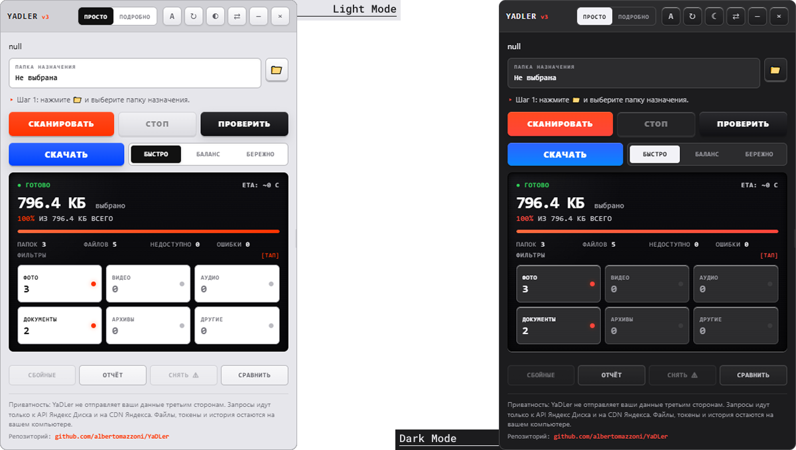
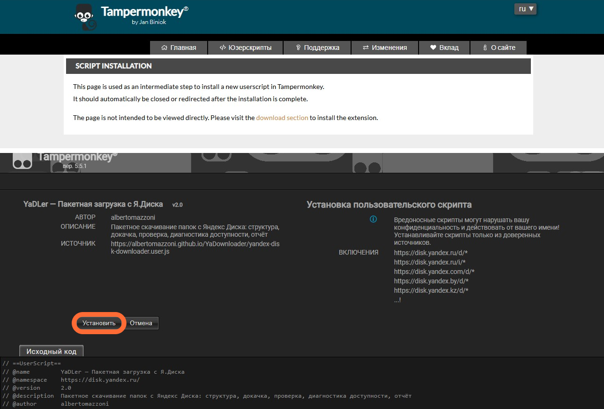
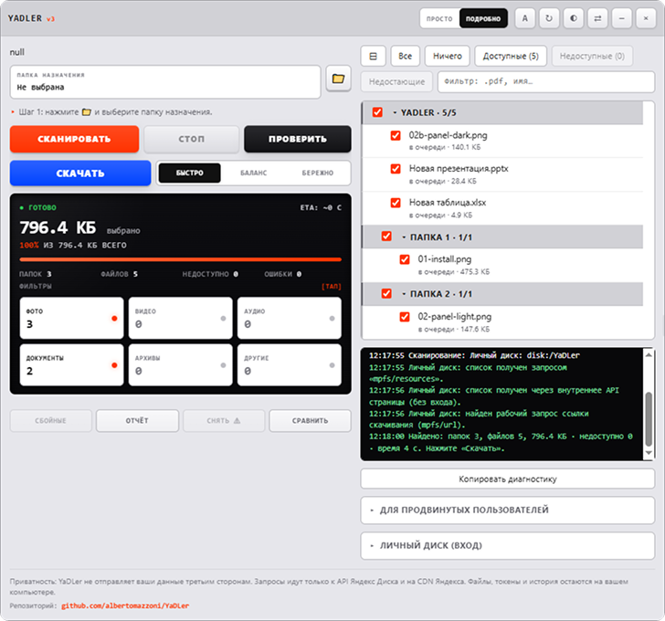

# YaDLer — Удобное пакетное скачивание файлов с Яндекс Диска

**YaDLer** — это мощный и легкий в использовании юзерскрипт для браузерных расширений (Tampermonkey/Violentmonkey). Он позволяет скачивать целые папки и файлы с Яндекс Диска напрямую на ваш компьютер, сохраняя оригинальную структуру директорий.

Инструмент разработан для повышения комфорта работы с облаком: никаких архиваторов, ожиданий распаковки больших ZIP-файлов или ручного перебора сотен документов. Просто выберите папку и нажмите «Скачать».

🔒 **Принципы безопасности и приватности:**
*   **Полностью бесплатно.** Без рекламы, подписок и скрытых платежей.
*   **Локальная работа.** Скрипт исполняется только в вашем браузере. Данные не отправляются на сторонние серверы автора.
*   **Без сбора телеметрии.** Ваша история загрузок, имена файлов и пути к папкам остаются исключительно на вашем устройстве.

## 🚀 Ключевые возможности

| Функция | Описание |
| :--- | :--- |
| 📂 **Пакетная загрузка** | Скачивание всей папки рекурсивно (включая подпапки) с сохранением дерева каталогов. |
| ⚡ **Мультипоточность** | Одновременная загрузка нескольких файлов для максимальной скорости использования канала. |
| 🛡️ **Проверка целостности** | Автоматическая сверка контрольных сумм (SHA-256) после загрузки. Если файл поврежден при передаче, он будет перезагружен автоматически. |
| 🔁 **Докачка и повтор попыток** | Устойчивость к временным сбоям сети. При обрыве соединения загрузка продолжается с места остановки или повторяется попытка. |
| 🎯 **Гибкие фильтры** | Возможность выбирать типы файлов для скачивания (только фото, только видео, документы и т.д.). |
| 📝 **Детальный отчет** | Генерация текстового файла `.txt` со статистикой успешных и неудачных загрузок по завершении процесса. |
| 🌙 **Темная тема** | Современный интерфейс, адаптированный под предпочтения системы или ручной выбор темы. |

## 📥 Установка

Для работы скрипта необходим менеджер пользовательских скриптов. Рекомендуемые браузеры: **Google Chrome**, **Microsoft Edge** (так как они имеют лучшую поддержку File System Access API для выбора папок сохранения).

### Шаг 1: Установите расширение Tampermonkey
Если у вас его еще нет, установите официальное расширение:
*   [Chrome Web Store](https://chrome.google.com/webstore/detail/tampermonkey/dhdgffkkebhmkfjojejmpbldmpobfkfo)
*   [Edge Add-ons](https://microsoftedge.microsoft.com/addons/detail/tampermonkey/iikmkjmpaadaobahmlepeloendndfphd)

### Шаг 2: Настройте разрешения
1.  Нажмите правой кнопкой мыши на иконку Tampermonkey в панели инструментов браузера.
2.  Выберите пункт **«Может читать и изменять данные сайтов»** (или аналогичный в настройках расширения).
3.  Убедитесь, что разрешение стоит как **«На всех сайтах»** (это необходимо для корректной работы перехвата контекста страницы Яндекс Диска).

### Шаг 3: Установите YaDLer
Перейдите по прямой ссылке для установки последней версии скрипта:

<h2>👉 <a href="https://albertomazzoni.github.io/YaDLer/yandex-disk-downloader.user.js"><strong>УСТАНОВИТЬ YADLER</strong></a> 👈</h2>

В открывшемся окне Tampermonkey нажмите кнопку **«Установить»**.

## 💻 Как пользоваться

Процесс интуитивно понятен и состоит из трех простых шагов:

### 1. Выбор папки назначения
Нажмите кнопку **«Папка…»** (значок 📁) в верхней части панели. Браузер предложит выбрать директорию на вашем компьютере, куда будут сохраняться файлы. 
> *Совет:* Включите опцию «Помнить папку между сессиями» в настройках, чтобы не выбирать ее каждый раз заново.

### 2. Сканирование содержимого
Откройте любую папку или файл на Яндекс Диске (по публичной ссылке или в личном кабинете). Панель YaDLer появится справа. Нажмите оранжевую кнопку **«Сканировать»**.
*   Скрипт проанализирует содержимое папки.
*   Вы увидите статистику: количество файлов, общий объем и распределение по типам (фото, видео, архивы).
*   Можно кликать по плиткам типов файлов, чтобы исключить ненужные категории из загрузки.

### 3. Загрузка
Выберите режим производительности и нажмите синюю кнопку **«Скачать»**:
*   **⚡ Быстрый:** Максимальная скорость, приоритет мелких файлов. Идеально для интернета высокой скорости.
*   **⚖ Баланс:** Стабильная нагрузка, средний приоритет. Рекомендуется по умолчанию.
*   **🐢 Бережный:** Минимальная нагрузка на сеть и сервер, приоритет крупных файлов. Полезно при нестабильном соединении.

Во время загрузки можно свернуть панель или уйти на другую вкладку — процесс продолжится в фоне. По завершении вы услышите звуковой сигнал и сможете открыть детальный отчет.

## ⚙️ Интерфейс и управление

Панель управления спроектирована в стиле минималистичного технического устройства (TE Design).

| Элемент | Назначение |
| :--- | :--- |
| **Шаги 1-2-3** | Индикатор текущего этапа работы (Папка -> Сканирование -> Загрузка). |
| **OLED Дисплей** | Живой статус процесса: прогресс-бар, текущая скорость, оставшееся время (ETA), количество ошибок. |
| **Матрица фильтров** | Быстрое включение/выключение категорий файлов (Фото, Видео, Аудио, Документы, Архивы, Другие). |
| **Переключатель вида** | Режим «Просто» (минимум элементов) и «Подробно» (список файлов, логи, продвинутые настройки). |
| **Кнопка ↻** | Проверка обновлений скрипта. |

## ❓ Часто задаваемые вопросы (FAQ)

<strong>💿 Почему скрипт бесплатный?</strong>

YaDLer создан автором для личных нужд, удобства друзей и сообщества. Проект распространяется свободно. Лучшая благодарность — послушать музыку человека, который вдохновил на создание этого скрипта. Ссылки на его стриминги вы найдете прямо в панели скрипта, в окошке поддержки автора.

<strong>🔒 Безопасны ли мои данные?</strong>

Да. Скрипт работает полностью изолированно в вашем браузере. Он взаимодействует только с сервисами Яндекс Диска через официальные механизмы доступа (ваша активная сессия браузера или публичные ссылки). Никакие ваши пароли, куки или имена файлов не передаются третьим лицам или на серверы разработчика.

<strong>❓ Почему требуется доступ ко всем сайтам?</strong>

Это техническое требование менеджеров скриптов (Tampermonkey) для того, чтобы скрипт мог корректно определять URL страниц Яндекс Диска и внедрять свой интерфейс в нужный момент. Сам скрипт активируется только на доменах `yandex.ru`, `yandex.com`, `yadi.sk` и связанных с ними региональных зонах.

<strong>🐢 Почему загрузка иногда замедляется?</strong>

Яндекс Диск имеет встроенные механизмы защиты от перегрузки сервера. Если вы запрашиваете слишком много данных одновременно, сервер может временно ограничить скорость ответа. Скрипт учитывает эти особенности: в режиме «Бережный» или при автоматической адаптации потоков он снижает интенсивность запросов, чтобы обеспечить стабильную доставку файлов без ошибок.

<strong>📦 Можно ли скачать папку одним архивом?</strong>

Нет, и это осознанное архитектурное решение. Скачивание отдельных файлов с сохранением структуры позволяет:
1. Видеть прогресс по каждому файлу в реальном времени.
2. Докачивать только те файлы, которые оборвались, без повторной загрузки всего архива.
3. Избежать риска повреждения большого ZIP-архива при сетевой ошибке.
4. Гибко фильтровать контент (например, скачивать только PDF, игнорируя тяжелые видео).

<strong>🌍 Работает ли скрипт в Firefox или Safari?</strong>

Скрипт совместим с этими браузерами, однако функция удобного выбора папки сохранения через диалог ОС (`showDirectoryPicker`) наиболее стабильно работает в Chromium-based браузерах (Chrome, Edge, Brave, Opera). В других браузерах файлы могут сохраняться в стандартную папку «Загрузки».

## 🤝 Поддержка и развитие

Проект активно развивается. Если вы нашли ошибку, предложили улучшение или столкнулись с проблемой при работе с новым дизайном Яндекс Диска, пожалуйста, создайте Issue в разделе [GitHub Issues](https://github.com/albertomazzoni/YaDLer/issues).

**Лицензия:** MIT © albertomazzoni